

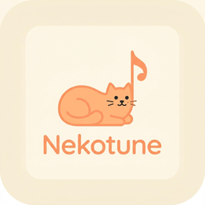

# NekoTune

**Musica con un gatto dentro.** 
Un lettore musicale gratuito per Windows: cerchi un brano, lo ascolti, lo salvi offline e lo condividi con gli amici.

 
-f2e6d2?labelColor=2e2a38)

### [⬇️ Scarica per Windows](https://github.com/Gattospia555/NekoTune/releases/latest) &nbsp;·&nbsp; [🏠 Entra nella stanza di Neko](https://gattospia555.github.io/NekoTune/)

<a href="https://gattospia555.github.io/NekoTune/">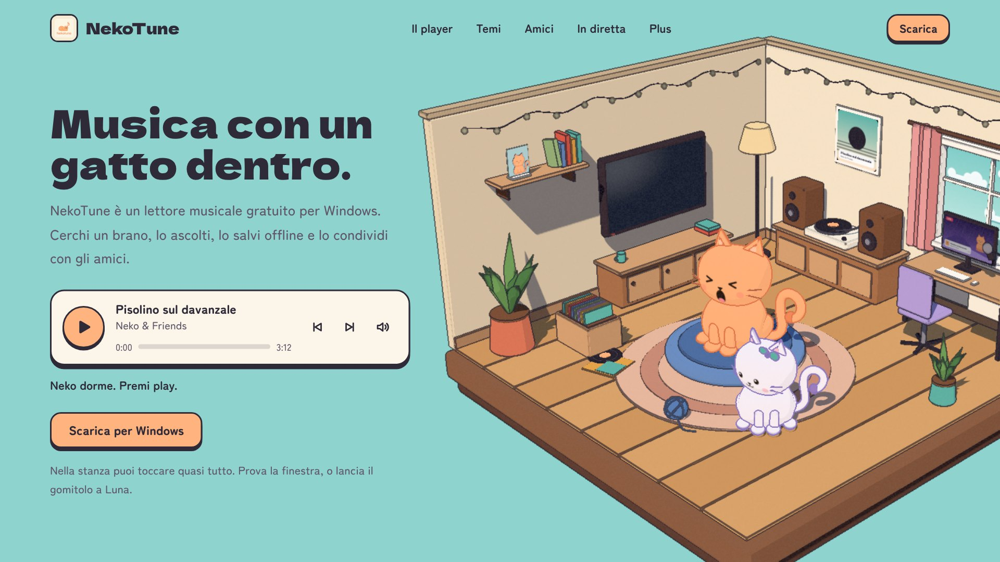</a>

---

## 🎧 Il player

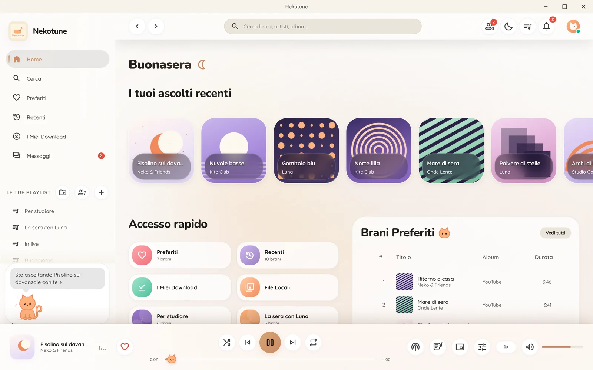

- **Il catalogo di YouTube Music**: brani, album, artisti, remix e cover.
- **Smart Radio**: quando la coda finisce, continua da sola con musica simile.
- **Una Home che ti conosce**: brani consigliati in base ai tuoi gusti, artisti e album in evidenza.
- **Offline**: salvi i brani e li ascolti anche senza internet, oppure li scarichi sul PC.
- **File locali**: anche la musica che hai già sul computer.

<table>
<tr>
<td width="50%">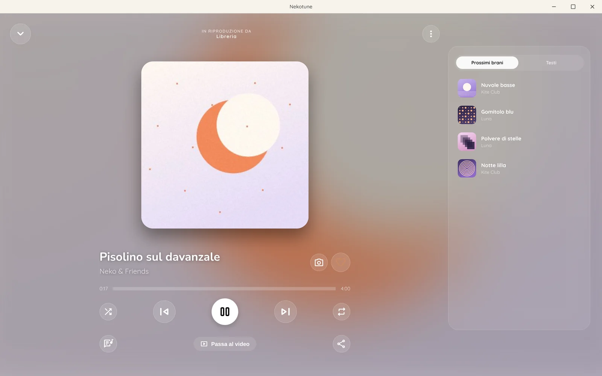</td>
<td width="50%">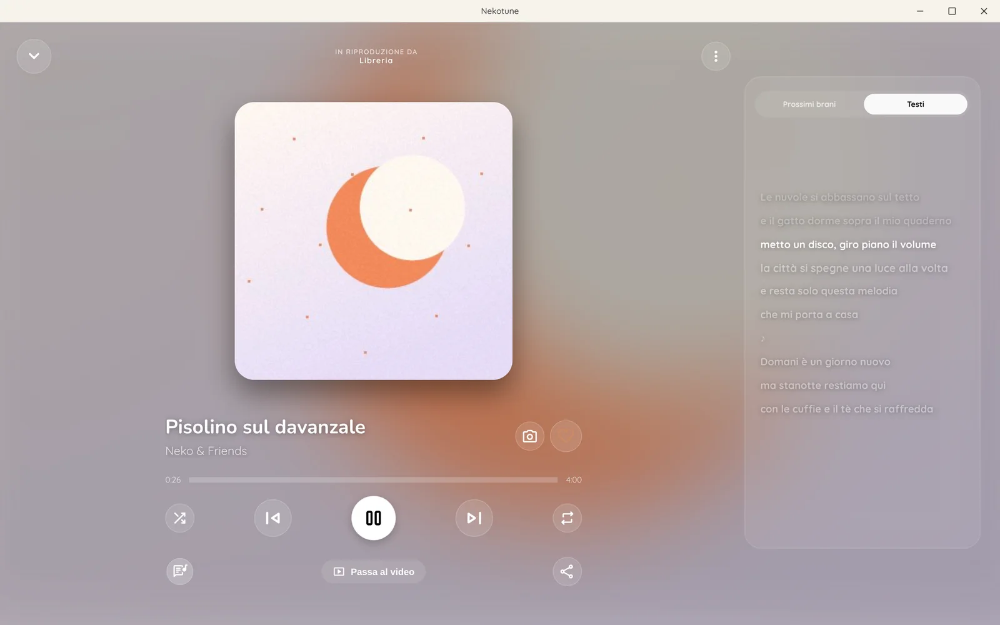</td>
</tr>
<tr>
<td align="center"><b>A tutto schermo</b>, quando il brano lo merita</td>
<td align="center"><b>Testi sincronizzati</b> che seguono la voce</td>
</tr>
</table>

## 🎨 Temi

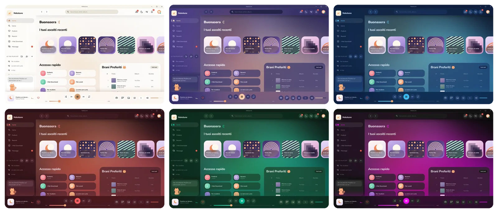

Sei temi pronti (Cozy Light, Warm Dark, Blu Notte, Tramonto, Foresta e Neon), più quelli che crei tu con NekoTune Plus.

## 🎚️ Il suono come piace a te

<table>
<tr>
<td width="42%">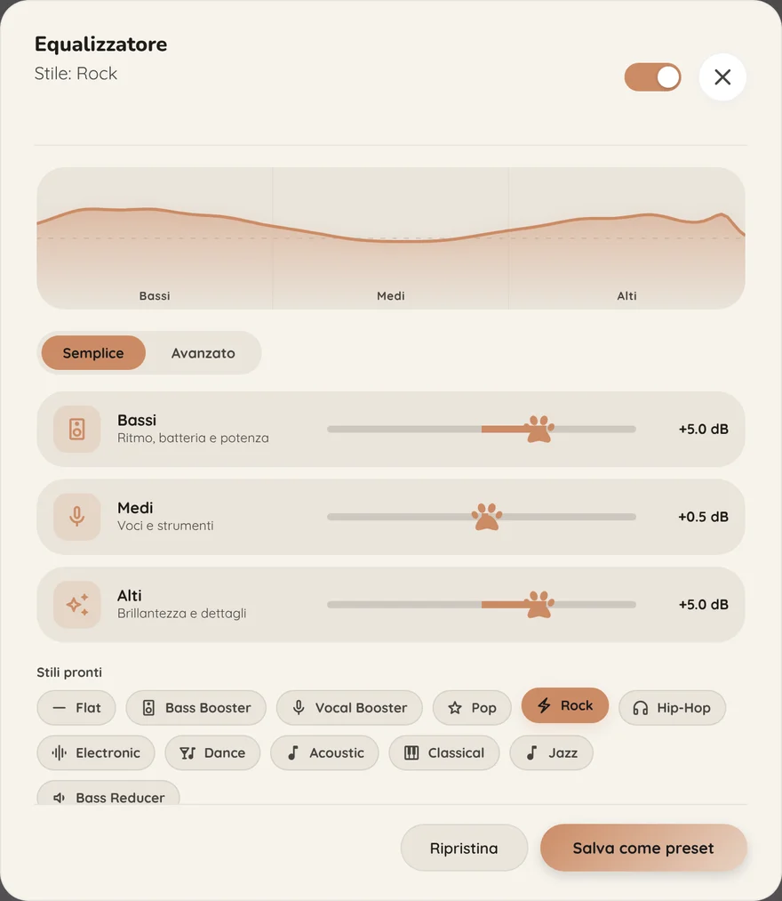</td>
<td>

- **Semplice**: bassi, medi e alti, con una curva che mostra cosa cambia.
- **Avanzato**: dieci bande per chi vuole tutto.
- **Stili pronti**: Rock, Pop, Acustico, Bass Booster e altri.
- **I tuoi preset**: salvi il suono che ti piace e lo ritrovi al prossimo avvio.

Ci sono anche **mini player** sempre in primo piano, **velocità di riproduzione** e **scorciatoie da tastiera**.

</td>
</tr>
</table>

## 🐾 Con gli amici è meglio

<table>
<tr>
<td>

- **Messaggi**: scrivi agli amici e mandi il brano che stai ascoltando con un clic.
- **Sessioni di gruppo**: la stessa musica nello stesso momento, con la chat accanto.
- **Playlist condivise**: una playlist che modificate in più persone.
- **Cosa ascoltano gli altri**: lo vedi accanto al loro nome e lo ascolti anche tu.
- **Ricompense**: badge, temi, bordi per l'avatar e sfondi del profilo da sbloccare con traguardi, codici e qualche segreto.

</td>
<td width="44%">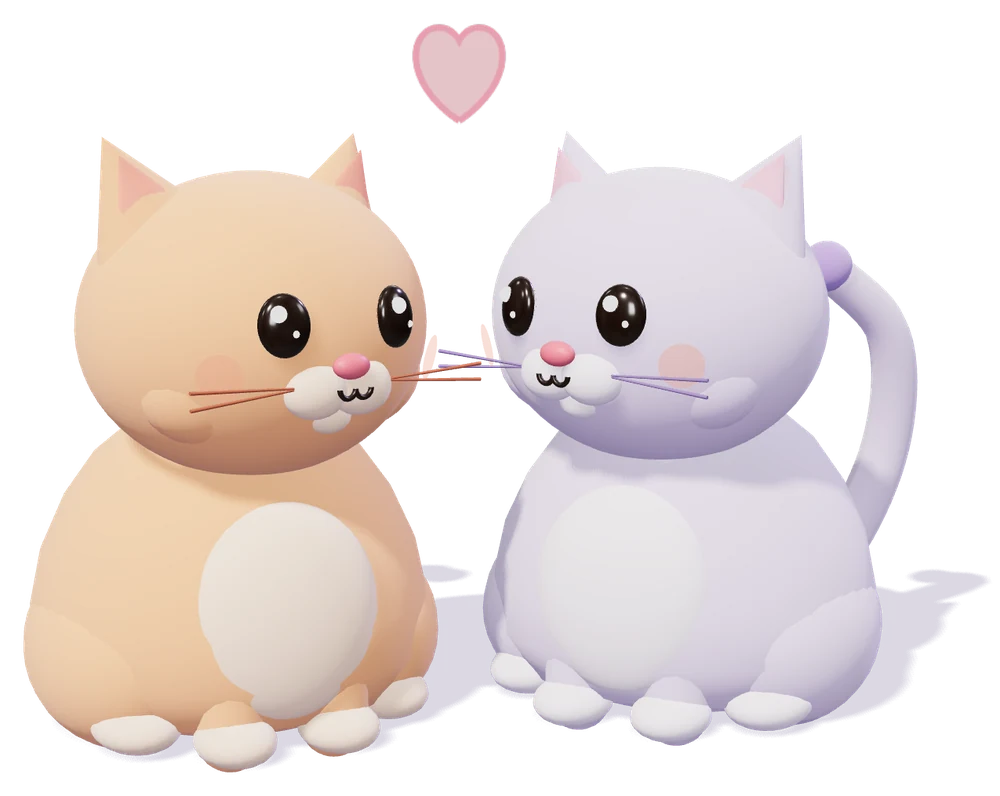</td>
</tr>
</table>

## 📺 In diretta

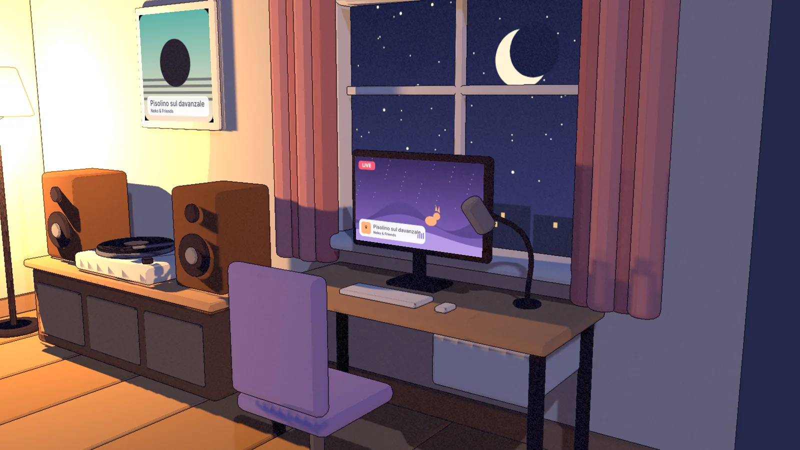

- **Widget per OBS**: il brano in riproduzione sopra la live, in tre stili, chiaro o scuro.
- **Attività su Discord**: "Sta ascoltando" sul tuo profilo, con copertina e tempo.
- **NekoBot**: con `/nekotune now` il tuo server vede cosa stai ascoltando.

## 🔒 Il tuo account resta tuo

<table>
<tr>
<td>

- **Verifica in due passaggi** con un'app Authenticator.
- **Dispositivi connessi**: vedi dove è aperto il tuo account e scolleghi quello che non riconosci.
- **I tuoi dati**: li scarichi tutti in un file o cancelli l'account quando vuoi, dalle impostazioni.
- **Backup**: con l'account, playlist e preferiti ti seguono su ogni computer.

L'account serve solo per amici, messaggi, sessioni e backup: per ascoltare non serve.

</td>
<td width="34%">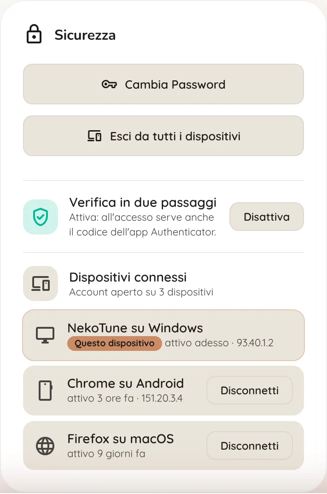</td>
</tr>
</table>

## ✨ NekoTune Plus

Tutto quello che serve per ascoltare è **gratis**. Plus è facoltativo e aiuta NekoTune a crescere.

| | NekoTune | NekoTune Plus |
|---|:---:|:---:|
| Musica, offline, testi, equalizzatore | ✅ | ✅ |
| Amici, messaggi, sessioni di gruppo | ✅ | ✅ |
| Sei temi pronti | ✅ | ✅ |
| Crei, modifichi e importi i tuoi temi | | ✅ |
| Ricompense riservate (tema, bordo e sfondo) | | ✅ |
| Annunci | qualcuno, discreto, nella Home | nessuno |
| Prezzo | **0 €** | **5 € al mese** |

Ci si abbona su [Ko-fi](https://ko-fi.com/narikoshinovt/tiers) e Plus si attiva da solo sul tuo account. Si disdice quando vuoi; rimborso entro 14 giorni dal primo pagamento ([termini](https://gattospia555.github.io/NekoTune/termini.html)).

## ⬇️ Installazione

1. Scarica **`NekoTune.Setup.x.y.z.exe`** dall'[ultima versione](https://github.com/Gattospia555/NekoTune/releases/latest).
2. Aprilo e segui l'installazione.
3. Le versioni successive arrivano da sole: NekoTune ti avvisa quando ce n'è una nuova.

> [!NOTE]
> L'installer non è ancora firmato, quindi Windows potrebbe mostrare **"Windows ha protetto il PC"**. Premi **Ulteriori informazioni → Esegui comunque**.

## ❓ Domande

<b>Da dove arriva la musica?</b>

 
Dal catalogo pubblico di YouTube e YouTube Music. NekoTune non ospita brani: li cerca e li riproduce per te.

<b>C'è per Linux o per telefono?</b>

 
Per ora NekoTune è per Windows 10 e 11. Sono in arrivo <b>Android</b> e <b>Linux</b>, e forse anche <b>iOS</b>.

<b>Funziona senza internet?</b>

 
Sì, con i brani che hai salvato offline nell'app o scaricato sul PC.

<b>Chi sono Neko e Luna?</b>

 
Neko è il gatto arancione che vive nell'angolo dell'app e reagisce alla musica. Luna è la sua amica lilla col fiocco: vive sul sito, e ogni tanto passa a trovare Neko anche nell'app. 🧶 <i>Psst: sul sito, prova a lanciarle il gomitolo un po' di volte.</i>

<b>Ho trovato un problema o ho un'idea</b>

 
Apri una <a href="https://github.com/Gattospia555/NekoTune/issues">issue</a> qui su GitHub, oppure scrivi a gattospia555@gmail.com.

## 📄 Cosa c'è in questa repository

Questa repository contiene **il sito** di NekoTune (cartella [`docs/`](docs), pubblicata con GitHub Pages, e i sorgenti della stanza 3D in [`site-src/`](site-src)) e **le versioni dell'app** nella pagina [Releases](https://github.com/Gattospia555/NekoTune/releases).

- [Termini e condizioni](https://gattospia555.github.io/NekoTune/termini.html) · [Privacy](https://gattospia555.github.io/NekoTune/privacy.html)
- NekoTune fa parte di **NekoEcoSystem**, insieme a NekoCalendar, NekoNotes e NekoBot.
- Caratteri del sito: Dela Gothic One e Zen Maru Gothic (SIL Open Font License).
- YouTube, Spotify, Discord e Ko-fi sono marchi dei rispettivi proprietari; NekoTune non è collegato a loro.

---

🇬🇧 <b>In English</b>

 

**NekoTune** is a free music player for Windows 10 and 11 (Android and Linux are on the way, maybe iOS too), with a cat inside. Search the YouTube Music catalog, listen, save songs offline and share them with friends: messages, group listening sessions, shared playlists, synced lyrics, an equalizer, six themes, an OBS widget, Discord status, two-step verification and unlockable rewards. The optional **NekoTune Plus** (€5/month on Ko-fi) adds custom themes, exclusive rewards and no ads.

[Download the latest release](https://github.com/Gattospia555/NekoTune/releases/latest) · [Website](https://gattospia555.github.io/NekoTune/) · [Terms](https://gattospia555.github.io/NekoTune/termini.html?lang=en) · [Privacy](https://gattospia555.github.io/NekoTune/privacy.html?lang=en)

If Windows shows "Windows protected your PC", choose **More info → Run anyway** (the installer is not signed yet).

 
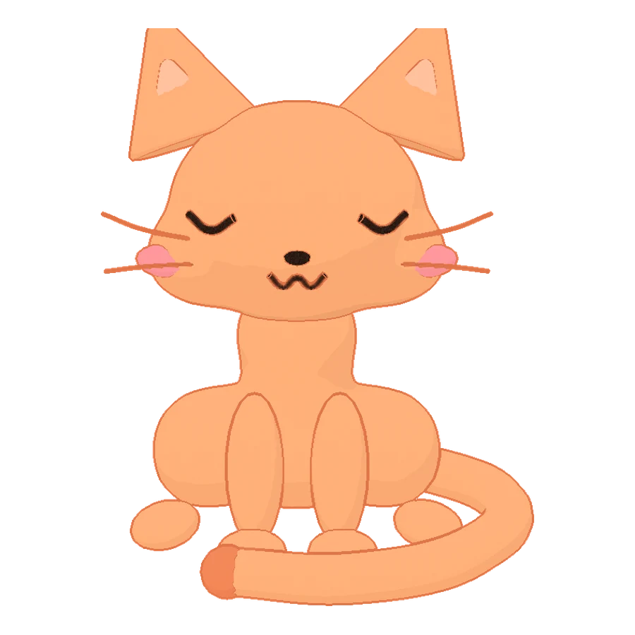
 
Fatto con ♥ (e qualche pisolino) da Gatto

